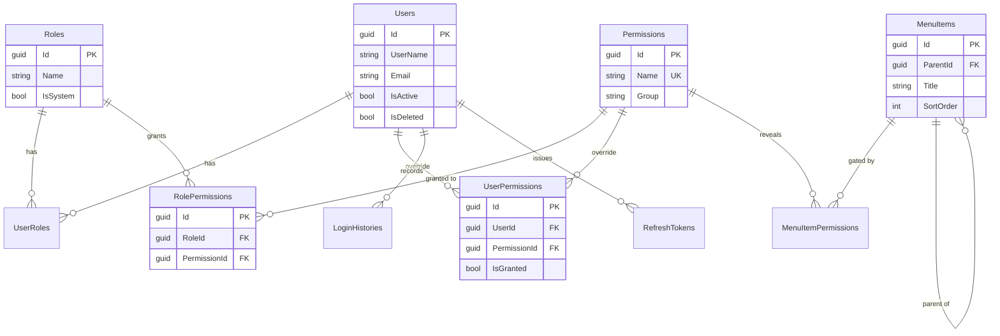
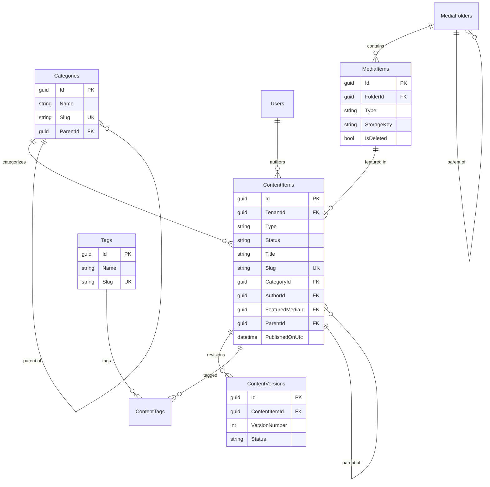
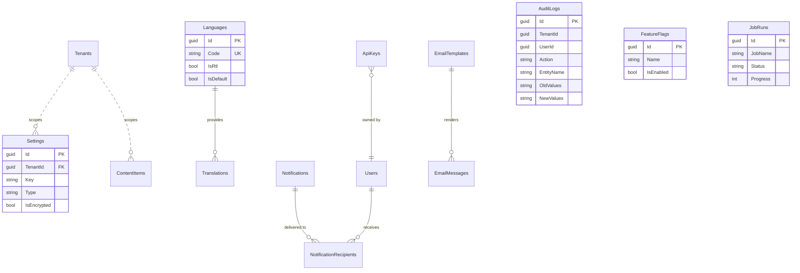

# Database Schema & Relationships

The CMS template ships a normalized SQL Server schema of **36 tables** managed by
EF Core. This document describes the entity groups, their relationships, and the
cross-cutting conventions. The diagrams use Mermaid and render on GitHub.

## Conventions

- **Keys** — all domain tables use `uniqueidentifier` (GUID) primary keys
  (`Entity<Guid>`). Identity tables also use GUID keys.
- **Auditing** — tables whose entities implement `IAuditable` carry
  `CreatedOnUtc/CreatedBy/ModifiedOnUtc/ModifiedBy`, stamped automatically by a
  SaveChanges interceptor.
- **Soft delete** — `ISoftDeletable` tables carry `IsDeleted/DeletedOnUtc/DeletedBy`;
  a global query filter hides deleted rows and hard deletes are rewritten to soft
  deletes.
- **Multi-tenancy** — `ITenantEntity` tables carry `TenantId`; a global query
  filter scopes them to the current tenant (single default tenant out of the box).
- **Enums** — persisted as strings (e.g. `ContentStatus`, `AuditAction`) for
  readability and stability.
- **Audit trail** — every insert/update/delete on an auditable entity is captured
  as an `AuditLogs` row with before/after JSON snapshots.

## Entity groups

| Group | Tables |
|-------|--------|
| **Identity & Access** | Users, Roles, UserRoles, UserClaims, UserLogins, UserTokens, RoleClaims, Permissions, RolePermissions, UserPermissions, LoginHistories, RefreshTokens |
| **Navigation** | MenuItems, MenuItemPermissions |
| **Content** | ContentItems, ContentVersions, Categories, Tags, ContentTags |
| **Media** | MediaFolders, MediaItems |
| **Configuration** | Settings, FeatureFlags, ApiKeys |
| **Localization** | Languages, Translations |
| **Notifications** | Notifications, NotificationRecipients |
| **Communication** | EmailTemplates, EmailMessages |
| **System / Observability** | AuditLogs, SystemLogs, JobRuns, ScheduledTasks |
| **Tenancy / Theming** | Tenants, Themes |

## Access control (permission-based authorization)



**Effective permissions** = (union of the user's roles' permissions) **+** explicit
user grants **−** explicit user denies. Menu visibility is filtered by the same set.

## Content & media



## Platform (config, localization, notifications, system)



> The `Tenants ||..o{` relationships are logical (enforced by query filters and the
> `TenantId` column) rather than physical foreign keys, so tenancy can be toggled
> without schema changes.

## Regenerating

```bash
# Add a migration after changing the model
dotnet ef migrations add <Name> \
  --project src/CMS.Infrastructure --startup-project src/CMS.Web \
  --output-dir Persistence/Migrations

# Apply to the database
dotnet ef database update --project src/CMS.Infrastructure --startup-project src/CMS.Web
```

The database is also migrated and seeded automatically on application startup
(`DatabaseInitializer`).
